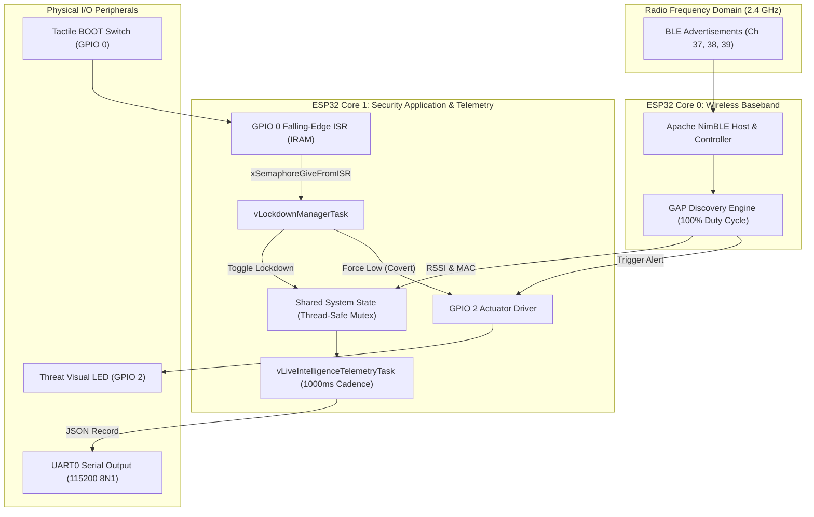
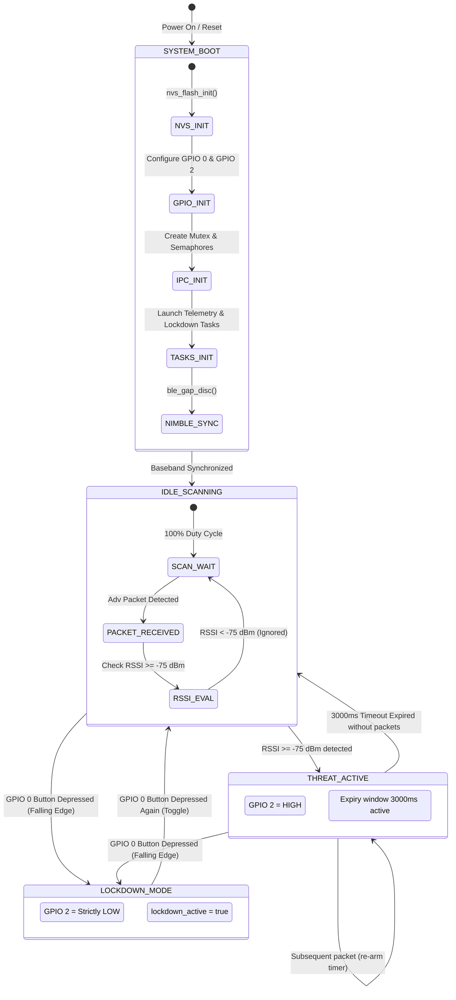
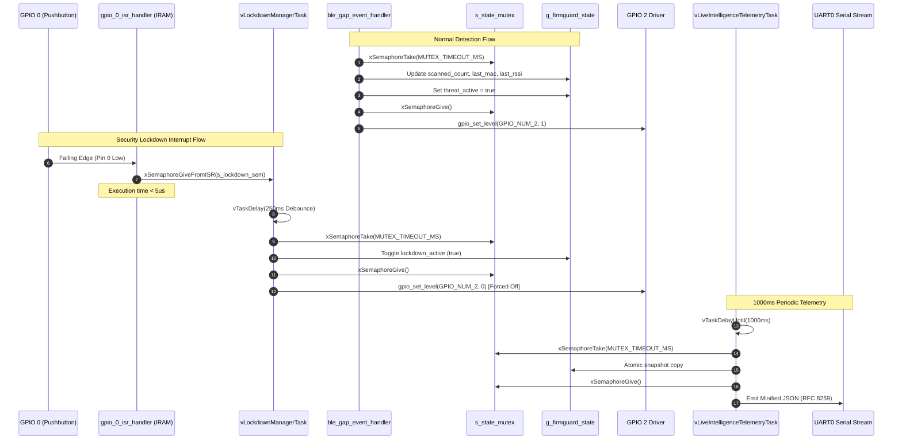

# FirmGuard-BLE System Design Document

**Firmware Version**: 1.0.0  
**Target Architecture**: Espressif ESP32 (Xtensa Dual-Core 32-bit LX6 @ 240 MHz)  
**RTOS / Framework**: ESP-IDF v5.5 / Apache NimBLE  
**Author**: Antigravity Firmware Team  

---

## 1. System Overview

FirmGuard-BLE is an embedded hardware security node designed to detect, classify, and report unauthorized Bluetooth Low Energy (BLE) tracking devices and beacons operating within physical proximity. The system combines:
1. Continuous passive/active BLE radio spectrum scanning using Apache NimBLE.
2. Immediate edge actuation via an onboard visual threat LED on GPIO 2.
3. An asynchronous security lockdown override via a hardware falling-edge ISR on GPIO 0.
4. A deterministic 1 Hz live JSON telemetry stream broadcast over UART0 at 115200 baud.

---

## 2. Hardware Pin Mapping

The firmware maps to standard ESP32 development modules (e.g. ESP32-WROOM-32, NodeMCU-32S, ESP32-DevKitC v4):

| GPIO Number | Signal Name | Electrical Characteristics | Target Peripheral / Circuit Connection |
|:---|:---|:---|:---|
| **GPIO 2** | `GPIO_THREAT_LED` | Digital Output, Push-Pull, 3.3V, Current Sourcing up to 12mA | Onboard Blue LED (Series resistor 470Ω to GND) / External Alarm Relay Buffer |
| **GPIO 0** | `GPIO_LOCKDOWN_BTN`| Digital Input, Internal Pull-Up (~45kΩ enabled), Falling-Edge Interrupt | Onboard tactile "BOOT" pushbutton connected to GND / External Security Switch |
| **GPIO 1** | `UART0_TXD` | Digital Output, 115200 Baud, 8N1 | Silicon Labs CP2102 or CH340 USB-to-UART Bridge TX line to Host PC |
| **GPIO 3** | `UART0_RXD` | Digital Input, 115200 Baud, 8N1 | Silicon Labs CP2102 or CH340 USB-to-UART Bridge RX line from Host PC |

---

## 3. Architecture Diagrams

### 3.1 High-Level Subsystem Architecture



---

### 3.2 Finite State Machine (FSM)



---

### 3.3 Task & Inter-Process Communication (IPC) Flow



---

## 4. Software Architecture Specifications

### 4.1 Apache NimBLE BLE Configuration
- **Operating Modes**: Observer / Central
- **Channel Map**: Channels 37, 38, 39
- **Scan Window**: 160 units (100 ms)
- **Scan Interval**: 160 units (100 ms)
- **Duty Cycle**: 100% continuous coverage
- **Duplicate Filter**: Disabled (`filter_duplicates = 0`) to provide live proximity monitoring of stationary and mobile trackers.

### 4.2 Telemetry Payload Specification
The telemetry engine outputs minified JSON once every 1000ms. Schema definition:

| JSON Key | Type | Description |
|:---|:---|:---|
| `uptime_ms` | `uint64` | System runtime in milliseconds since boot |
| `scanned_count` | `uint32` | Total advertising packets detected |
| `threat_count` | `uint32` | Total packets meeting or exceeding -75 dBm threshold |
| `threat_active` | `boolean` | `true` if target currently within proximity hold window |
| `lockdown_active`| `boolean` | `true` if operator emergency lockdown override is engaged |
| `last_mac` | `string` | Colon-separated hex representation of last advertiser |
| `last_rssi` | `integer` | Signal strength in dBm of last advertisement |
| `free_heap` | `uint32` | Instantaneous remaining internal SRAM in bytes |

---

## 5. Build, Flash, and Verification Instructions

### 5.1 Prerequisites
- **Framework**: ESP-IDF v5.5 (or v5.x compatible toolchain)
- **Python**: Python 3.10+
- **Serial Drivers**: CP210x or CH34x USB VCP driver installed

### 5.2 Project Build Procedure

Open an ESP-IDF terminal in the project directory:

```bash
# 1. Set the target chip architecture to ESP32
idf.py set-target esp32

# 2. Compile the firmware binary and link components
idf.py build
```

### 5.3 Device Flashing Procedure

Connect the ESP32 board to the host PC via USB:

```bash
# Flash the firmware at 460800 baud (replace COM3 with your port, e.g. /dev/ttyUSB0 on Linux)
idf.py -p COM3 -b 460800 flash
```

### 5.4 Serial Monitoring & Telemetry Inspection

Launch the ESP-IDF serial monitor:

```bash
idf.py -p COM3 monitor
```

To exit the monitor, use the shortcut: `Ctrl + ]`.

### 5.5 Unit Test Execution

To compile and execute the automated Unity test suite:

```bash
# Build unit test runner
idf.py -T test build

# Flash unit test runner to target hardware
idf.py -T test -p COM3 flash monitor
```
